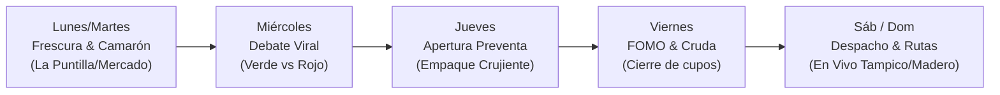

# 📘 BRAND BOOK & GUÍA DE DIRECCIÓN CREATIVA
## "La Garza Aguachilera" — Tampico & Ciudad Madero
*Agencia de Marketing Gastronómico & servicio exclusivo a domicilio Estratégica*

---

## 1. INTRODUCCIÓN Y MANIFIESTO DE MARCA

En el corazón de la zona conurbada (Tampico, Ciudad Madero y Altamira) no se come para sobrevivir: **se come con pasión, con limón en la mano y con orgullo de costa**.

**La Garza Aguachilera** nació para romper la monotonía de la botana tradicional y del aguachile de mantel largo. Tomamos el platillo más codiciado del litoral mexicano —el aguachile fresco, frío y picoso— y lo fusionamos con la reina de las botanas callejeras: **la bolsa de Tostitos**.

> ### 📢 Manifiesto:
> *"No somos marisquería de lujo ni botana cualquiera de esquina. Somos la cura sagrada del domingo, el antojo pecaminoso del sábado y el orgullo de comer camarón de adeveras bien reportado. Si cruje, si pica sabroso y si te hace cerrar los ojos del antojo... es La Garza."*

---

## 2. IDENTIDAD VERBAL Y TONO DE VOZ

### 2.1 Arquetipo de Marca
* **Arquetipo Principal:** *El Amigo Anfitrión & El Rebelde Sabroso*.
* **Personalidad:** Joven, costeño, fiestero, transparente, alivianado, cariñoso y obsesionado con la calidad de la comida. Habla de tú a tú, como el amigo con el que te vas a Playa Miramar o te sientas a ver el partido.

### 2.2 Pilares de Comunicación
1. **Orgullo 100% Tampiqueño:** No imitamos a Sinaloa ni a CDMX; hablamos con el ADN de la conurbada (el calorón, la brisa de Miramar, el Puente Tampico, el mercado de La Puntilla).
2. **Food Porn Real (Transparencia Total):** Mostramos los camarones grandes, limpios en corte mariposa, el limón escurriendo y el crujido real sin filtros engañosos.
3. **Respeto a la Botana (Cero Tostitos Remojados):** Nuestro diferenciador logístico es sagrado: el aguachile se envía en montaje en vivo sobre mesa plegable frente a ti para que el cliente viva el "crunch" perfecto en su casa.
4. **Sentido de Urgencia & Exclusividad (FOMO):** Solo cocinamos en fin de semana con camarón fresco de costa. Quien no aparta en preventa entre semana, se queda con el antojo.

### 2.3 Glosario Tampiqueño Dosificado (Brand Vocabulary)

| Término / Frase Local | Significado & Uso en la Marca | Ejemplo de Copy / Diálogo |
| :--- | :--- | :--- |
| **"Bien reportado"** | Porción generosa, abundante de camarón, sin pichicatear. | *"Aquí tu bolsa viene bien reportada de camarón, nada de pura verdura."* |
| **"La Conurbada"** | Tampico y Ciudad Madero (nuestro territorio de entrega). | *"Llegamos a toda la conurbada hasta la puerta de tu cantón."* |
| **"La Cura de la Cruda"** | El poder revividor del limón, el serrano y el camarón frío. | *"Si ayer te excediste, este tostiaguachile es tu medicina oficial."* |
| **"Miramar" / "La Playa"** | Referente emocional de calor, cerveza y descanso de fin de semana. | *"Sabor a domingo en Miramar sin tener que hacer fila."* |
| **"De adeveras"** | Autenticidad, camarón grande y fresco sin engaños. | *"Camarón del Golfo de adeveras, limpio y en corte mariposa."* |
| **"Calorón"** | El clima húmedo y caluroso que exige algo helado y acidito. | *"Con este calorón tampiqueño solo se antoja un aguachile heladito."* |
| **"Chulada"** | Admiración culinaria genuina ante el plato montado. | *"Mira nomás qué chulada de verde con su cebollita morada."* |

### 2.4 Reglas de Oro Verbales (Do's & Don'ts)

| ✅ LO QUE SÍ DECIMOS | ❌ LO QUE NUNCA DECIMOS |
| :--- | :--- |
| "Camarón fresco del Golfo curado en limón Colima al momento" | "Producto congelado descongelado con aderezo" |
| "Te mandamos el preparado frente a ti para que tus Tostitos sigan crujientes" | "Disculpe si le llegan remojados por la moto" |
| "Arma tu preventa por WhatsApp para asegurar tu cupo" | "A ver si nos queda algo el domingo" |
| "Bien reportado de marisco, como nos gusta aquí" | "Porción individual estandarizada" |
| "Verde fresco o Rojo Flamin bravo" | "Picante nivel 1 y nivel 2" |

---

## 3. IDENTIDAD VISUAL Y CROMÁTICA

Nuestra identidad visual rinde homenaje directo al logotipo oficial: la majestuosa garza blanca del Golfo, el emblemático Puente Tampico atirantado, el molcajete rebosante de aguachile y la frescura marina.

```
+-------------------------------------------------------------------------+
|                  PALETA CROMÁTICA "LA GARZA AGUACHILERA"                |
+---------------------+---------------------+-----------------------------+
| Color               | Código HEX          | Uso en Marca                |
+---------------------+---------------------+-----------------------------+
| Azul Marino Garza   | #0D2238             | Fondos, texto principal     |
| Azul Océano Tampico | #0284C7             | Botones, acentos de frescura|
| Verde Lima Serrano  | #84CC16             | Tostitos Verdes, tags éxito |
| Rojo Flamin Bravo   | #DC2626             | Tostitos Rojos, urgencia    |
| Naranja Camarón     | #F97316             | Destacados, ofertas, badge  |
| Blanco Espuma       | #FFFFFF             | Contraste, texto en fondo   |
| Crema Botana        | #FAF9F5             | Fondo web y fondos limpios  |
+---------------------+---------------------+-----------------------------+
```

### 3.1 Tipografías para Redes Sociales
1. **Titulares de Impacto (Reels / TikTok / Miniaturas):**
   * *Fuente:* **Montserrat Black / Extra Bold** o **The Bold Font** (con bordes negros nítidos y sombra paralela sutil para legibilidad en pantalla chica).
   * *Color de subtítulos CapCut:* Amarillo sol (`#FACC15`) con contorno negro o Blanco puro con caja azul marino.
2. **Cuerpo de Texto y Menús (Stories y Web):**
   * *Fuente:* **Montserrat SemiBold / Medium** (limpia, moderna, 100% legible en dispositivos móviles).

---

## 4. GUÍA DE DIRECCIÓN DE ESCENA: EL ROSTRO VISIBLE DE LA MARCA

La chica del negocio es el mayor activo de confianza y magnetismo de La Garza Aguachilera. No es una modelo fría ni una edecán lejana: **es la dueña carismática, atractiva, auténtica y apasionada que prepara y disfruta la botana más irresistible de Tampico**.

```
+------------------------------------------------------------------------+
|                     EL PERSONAJE EN CÁMARA                             |
|                                                                        |
|  [ Sonrisa cálida ]  --->  [ Pasión gastronómica ]  ---> [ Cercanía ]  |
|   "Ojos a cámara"          "Manipula el camarón"          "Voz de amiga"|
+------------------------------------------------------------------------+
```

### 4.1 Lenguaje Corporal y Actitud
* **Contacto visual directo:** Mirar al lente de la cámara (no a la pantalla de previsualización del celular). Habla como si le contara un chisme jugoso a su mejor amiga.
* **Sonrisa magnética y microgestos:** Sonreír al inicio de cada video, abrir ligeramente los ojos al mencionar el limón o el picor, levantar las cejas con tono cómplice.
* **Uso activo de las manos:** Sostener la bolsa de tostitos en plano medio a la altura del pecho; agitar el contenedor del aguachile para mostrar la frescura; verter el caldo lentamente con precisión hipnótica.
* **La Mordida de Validación (Bite Test):** Probar el tostito en cámara con sonido crujiente real, cerrar los ojos medio segundo como gesto involuntario de placer ("¡Uff, qué delicia!") y sonreír satisfecha.

### 4.2 Código de Vestuario y Estilismo (Wardrobe Guide)
Para que los videos transmitan limpieza culinaria, frescura costera y resalten su atractivo natural sin verse sobrecargada:

1. **Colores Recomendados:**
   * **Blanco nítido:** Playeras de cuello redondo o tipo polo sin estampados grandes, tops casuales frescos. El blanco comunica máxima higiene en preparación de alimentos y hace resaltar su tono de piel y el color de los mariscos.
   * **Azul Marino o Azul Celeste:** Coherencia total con los colores de la marca y el logotipo.
   * **Acentos Verde Lima o Naranja Cálido:** En delantal limpio, gorra o coletero de cabello.
2. **Evitar estrictamente:**
   * Ropa con logos gigantes de otras marcas (Nike, Adidas, etc.).
   * Estampados florales o geométricos ruidosos que distraigan la atención visual del camarón.
   * Colores oscuros apagados (café, gris rata) que resten energía.
3. **Arreglo y Cabello:**
   * Cabello recogido en media coleta pulida o coleta alta con mechones al frente (despeja el rostro para ver sus expresiones faciales y transmite pulcritud higiénica).
   * Uñas limpias y arregladas (tonos neutros, rojos o nude), ya que las tomas de detalle (B-Roll) enfocarán sus manos abriendo la bolsa y exprimiendo limones.
   * Maquillaje natural "glowy" playero: piel luminosa, rímel que abra la mirada, brillo o tinta en labios color durazno/coral.

---

## 5. PLANO TÉCNICO DE CÁMARA, ILUMINACIÓN Y AUDIO

No se requiere una cámara de cine de $50,000 MXN. Un iPhone 12 en adelante o un Android gama media-alta bien configurado genera resultados de clase mundial siguiendo estas reglas:

```
                  [ LUZ PRINCIPAL (Ventana / Softbox 45°) ]
                                     \
                                      \
[ REBOTE BLANCO ] <--- ( ELLA + MESA DE COMIDA ) ---> [ CÁMARA EN TRÍPODE ]
                                                          (A la altura de ojos)
```

### 5.1 Configuración de Cámara del Teléfono
* **Resolución:** 4K a 60 fps (permite hacer tomas en cámara lenta nítidas de salsas y camarones) o 1080p a 60 fps.
* **Limpieza de lente obligatoria:** Limpiar el lente de la cámara con paño de microfibra antes de cada toma (la grasa de los dedos crea neblina que arruina el video).
* **Bloqueo de Exposición/Enfoque (AE/AF Lock):** Mantener presionado en la comida para que la luz no parpadee mientras se vierte el aguachile.

### 5.2 Planimetría de Tomas (A-Roll vs B-Roll)

```
+--------------------------------------------------------------------------+
| TIPOS DE TOMA            | ENCUADRE                    | PROPÓSITO       |
+--------------------------+-----------------------------+-----------------+
| A-Roll (Ella a cámara)   | Plano medio (cintura/pecho) | Conexión, hook  |
| B-Roll Macro (45°)       | Primer plano cerrado (10cm) | Antojo, texturas|
| B-Roll Cenital (90°)     | Vista aérea de la bolsa     | Vertido de salsa|
| B-Roll Bite Shot         | Primer plano boca/tostito   | Sonido CRUNCH   |
+--------------------------+-----------------------------+-----------------+
```

1. **A-Roll (Ella a Cámara):**
   * *Ángulo:* A la altura exacta de sus ojos o 5° ligeramente picada.
   * *Distancia:* 1 a 1.5 metros de distancia con lente estándar (1x), nunca con gran angular ultra-wide para evitar deformación de rostro.
2. **B-Roll Macro de Alimentos (Food Porn puro):**
   * *Ángulo a 45°:* La perspectiva natural de quien está sentado frente a la comida listo para meter la mano.
   * *Tomas dinámicas lentas:* Movimiento suave de acercamiento (slow zoom-in) mientras los camarones caen sobre la cama de Tostitos.
3. **Tomas de "Vertido" (The Pour Shot):**
   * Cámara fija en trípode a 30 cm de la bolsa abierta. El caldo verde o rojo cae en cascada sobre los Tostitos y se empapa el pepino y la cebolla.

### 5.3 Iluminación Casera Profesional
* **Esquema de Luz Natural (La más económica y bella):** Grabar entre las 11:00 AM y las 3:00 PM frente a una ventana amplia que reciba luz difusa indirecta (sin sol directo que queme la imagen). Ella colocada a 45° de la ventana.
* **Reflector Casero:** Una cartulina blanca o placa de unicel del lado opuesto de la ventana para rebotar la luz y rellenar sombras suaves en el rostro y la comida.
* **Esquema con Luz Artificial:** Un aro de luz LED de mínimo 12 pulgadas o una lámpara softbox colocada a 45° un poco más alta que la cabeza, apuntando hacia abajo con luz neutra (4500K - 5000K). *Prohibido usar focos amarillos incandescentes de techo*.

### 5.4 Audio y Microfonía (El 50% de la Retención)
* **Micrófono Lavalier inalámbrico (Tipo K8/K9 Lightning/USB-C o Hollyland Lark):**
  * Para los diálogos de ella: Sujeto en el cuello de su playera a 15 cm de la boca.
  * Para el ASMR de comida: Quitar el micrófono de la playera y acercarlo a 5 cm de la bolsa al verter el caldo o al morder el tostito para captar la vibración crujiente en seco.

---

## 6. CALENDARIO SEMANAL DE CONTENIDO ORGÁNICO



* **Lunes:** Descanso de cocina / Historia estética de compras de insumos frescos.
* **Martes:** Video de curiosidad / Calidad del camarón / ASMR de corte mariposa.
* **Miércoles:** Video de debate polarizante en TikTok e Instagram (generador de comentarios masivos).
* **Jueves:** Lanzamiento oficial de preventa con video resolviendo objeción (empaque crujiente) y link a WhatsApp.
* **Viernes:** Campaña de escasez (últimos 15 cupos) + Pauta de Meta Ads activa.
* **Sábado y Domingo:** Historias en tiempo real: bolsas saliendo, rutas activas en colonias conocidas, fotos de clientes recibiendo su pedido.
