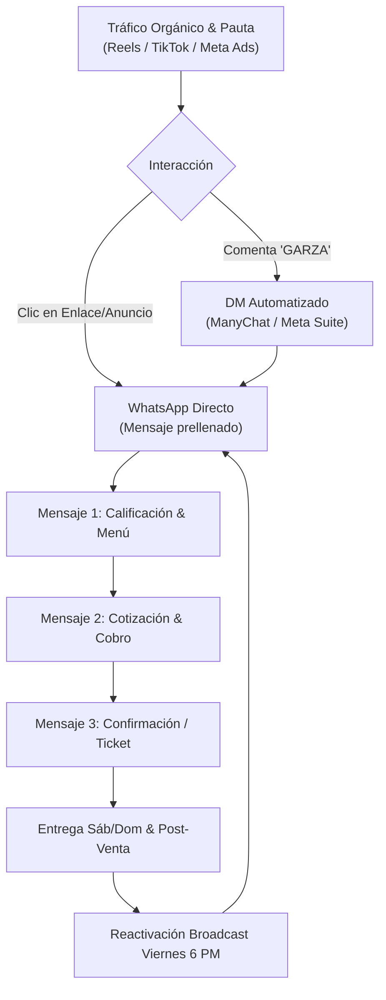

# 📲 EMBUDO DE CONVERSIÓN & WHATSAPP SALES MACHINE
## "La Garza Aguachilera" — Tampico & Ciudad Madero
*Cierre de Ventas en Menos de 3 Mensajes, Automatización y Recompra*

---

## 1. ARQUITECTURA DEL EMBUDO DE CONVERSIÓN

El objetivo del sistema de ventas de La Garza Aguachilera es **reducir a cero la fricción entre el antojo visual y el cobro en dinero**. 



---

## 2. AUTOMATIZACIÓN DE COMENTARIOS EN INSTAGRAM & FACEBOOK

Cuando un usuario comenta en un Reel o Post de Instagram/Facebook, el algoritmo premia la publicación por engagement y ManyChat (o la suite de Meta) le responde de inmediato en privado sin intervención manual.

### 2.1 Configuración de Palabras Clave (Triggers)
* **Palabras detonadoras:** `GARZA`, `QUIERO`, `ANTOJO`, `PRECIO`, `VERDE`, `ROJO`, `MENU`.

### 2.2 Flujo Automatizado por DM (Mensaje Directo):

1. **Respuesta pública al comentario (Variación automática para evitar spam de Instagram):**
   * Opción A: *"¡Listo! Ya te mandé los detalles a tu buzón privado 🦐📥"*
   * Opción B: *"¡Uff, prepárate para el crunch! Te mandé el menú por DM 👀✨"*
   * Opción C: *"¡Excelente elección! Revisa tus mensajes directos para apartar el tuyo 🟢🔴"*

2. **Mensaje Privado (DM) Instantáneo:**
```text
¡Hola! 🦐 Gracias por escribirnos a La Garza Aguachilera.

Aquí tienes nuestro menú de Tostiaguachiles con camarón fresco curado al momento:

🟢 Tostitos Verdes ($150): Con serrano, pepino, cebolla y limón Colima.
🔴 Tostitos Rojos ($150): Con Tostitos Flamin, chiles tatemados y salsas oscuras.

📦 *Recuerda:* El caldo de aguachile y los camarones van en su hielera térmica con preparación frente a ti para que tus tostitos lleguen 100% crujientes a tu casa en Tampico o Madero.

👇 Para apartar tu lugar en la ruta de este fin de semana, toca aquí y te atendemos directo en WhatsApp:
👉 https://wa.me/528332520988?text=Hola!%20Vengo%20de%20Instagram%20y%20quiero%20apartar%20mi%20Tostiaguachile
```

---

## 3. PROTOCOLO DE CIERRE EN WHATSAPP EN MENOS DE 3 MENSAJES

El mayor error de los negocios de comida es contestar con biblias de texto o hacer 10 preguntas que cansan al cliente. Aquí cerramos la venta con precisión quirúrgica:

```
[ MENSAJE 1 ]  Saludo + Menú ultracompacto + Pregunta Calificadora (Día y Colonia)
[ MENSAJE 2 ]  Total con envío + Métodos de Pago + Solicitud de Dirección
[ MENSAJE 3 ]  Ticket Confirmado + Rango de Horario + Tip del Crunch
```

---

### MENSAJE 1 (Respuesta Inmediata al saludo del cliente):
> **Objetivo:** Saludar con calidez, mostrar el precio y obtener los datos para cotizar en una sola respuesta.

```text
¡Hola! 🦐 Qué gusto saludarte, bienvenido a *La Garza Aguachilera*. 🌊

Preparamos los tostiaguachiles más reportados de Tampico y Madero con camarón fresco curado al momento. 

📋 *NUESTRAS OPCIONES ($150 MXN la bolsa):*
🟢 *Tostitos Verdes:* Aguachile clásico de serrano, pepino, cebolla morada y limón Colima.
🔴 *Tostitos Rojos:* Aguachile bravo con chiles tatemados, salsas oscuras y Tostitos Flamin.

💡 *Garantía de sabor:* El caldito y los camarones van en contenedor hermético aparte para que tus tostitos lleguen 100% crujientes a tu mesa.

Para agendar tu pedido en la ruta:
👉 **¿Cuántas bolsas deseas, para qué día (Sábado o Domingo) y en qué colonia te encuentras?** 🙌
```

---

### MENSAJE 2 (Al recibir la respuesta del cliente):
> *Ejemplo del cliente:* "Quiero una verde y una roja para el domingo en la colonia Petrolera".
> **Objetivo:** Dar la suma matemática exacta, costo de envío y pedir confirmación de pago.

```text
¡Perfecto! Te apartamos **1 Verde Clásico + 1 Rojo Flamin** para este **Domingo** en Col. Petrolera. 🦐🔥

💰 *TOTAL A PAGAR:*
• 2 Bolsas de Tostiaguachiles: $300 MXN
• Envío en Col. Petrolera: $30 MXN
• **Total final: $370 MXN**

¿Cómo prefieres pagar tu pedido?
1️⃣ **Transferencia bancaria / SPEI (Recomendado):**
   * Banco: BBVA (o Nu / Mercado Pago)
   * CLABE: [Escribe aquí tu CLABE de 18 dígitos]
   * Beneficiario: La Garza Aguachilera
2️⃣ **Efectivo al recibir** *(por favor indícanos con qué billete pagas para mandar tu cambio exacto)*.

Por favor compártenos:
📍 **Calle, Número exterior e interior:**
🧭 **Referencias (entre calles, color de fachada o reja):**
👤 **Nombre de quien recibe:**
```

---

### MENSAJE 3 (Al confirmar pago o datos de entrega):
> **Objetivo:** Enviar el ticket oficial, generar tranquilidad y blindar la entrega.

```text
✅ *¡PEDIDO 100% CONFIRMADO!* 🦐🛵

📋 *RESUMEN DE TU ENTREGA:*
• **Día:** Domingo
• **Pedido:** 1 Tostitos Verdes + 1 Tostitos Rojos Flamin
• **Dirección:** [Calle y Número], Col. Petrolera, Tampico.
• **Rango estimado de entrega:** 1:30 PM – 3:00 PM
• **Total:** $370 MXN *(Pagado / Efectivo)*

💡 *Tip del Chef Garza al recibirlo:*
Destapa el contenedor con los camarones y el aguachile heladito, viértelo sobre tu bolsa de Tostitos abierta... ¡y disfruta el crunch perfecto sin tostitos remojados!

Te escribiremos por aquí en cuanto el repartidor vaya rumbo a tu domicilio. ¡Gracias por tu preferencia! 🌊✨
```

---

## 4. ATAJOS DE TECLADO (RESPUESTAS RÁPIDAS EN WHATSAPP BUSINESS)

Guarda estos atajos con la barra inclinada `/` para contestar en 3 segundos:

### `/menu`
```text
🦐 *MENÚ LA GARZA AGUACHILERA:*
🟢 *Tostitos Verdes ($150):* Aguachile clásico con chile serrano, pepino, cebolla morada y limón Colima.
🔴 *Tostitos Rojos ($150):* Aguachile bravo con chiles tatemados, salsas oscuras y Tostitos Flamin.
📦 *Empaque inteligente:* Camarones y caldo en contenedor hermético aparte para que la botana llegue crujiente.
🛵 Entregas a domicilio Sábados y Domingos en Tampico y Cd. Madero.
```

### `/zonas`
```text
🛵 *TARIFAS DE ENVÍO A DOMICILIO:*
(Base de salida: Colonia Flores, Tampico, Tamaulipas)

📍 *Zona 1 ($25 - $30 MXN):* Col. Flores, Guadalupe, Sierra Morena, Altavista, Petrolera, Lomas de Rosales, Jardín, Campbell.
📍 *Zona 2 ($35 - $45 MXN):* Centro de Tampico, Cascajal, Tamaulipas, Ampliación Unidad Nacional, Unidad Nacional (Madero), Los Pinos.
📍 *Zona 3 ($50 - $70 MXN):* Zona Norte (Tampico 2000, Arenal, Tancol), Centro Madero, Playa Miramar.

🎁 *PROMOCIÓN:* ¡En pedidos de 3 o más bolsas el envío en Zona 1 es GRATIS!
```

### `/pago`
```text
💳 *DATOS DE PAGO:*
• Banco: [Tu Banco / BBVA / Nu]
• CLABE Interbancaria: [Inserta aquí tu número CLABE]
• Titular: [Nombre del titular]
• Concepto: [Tu Nombre o "Aguachile"]

O si prefieres efectivo contra entrega, solo avísanos con cuánto billete pagas para que el repartidor lleve tu cambio listo. 🙌
```

### `/empaque`
```text
💡 *¿Cómo cuidamos tus Tostitos?*
Para que no te lleguen aguados ni batidos por el camino:
1. Te entregamos la bolsa de tostitos crujientes y secos con su pepino y cebollita morada.
2. En un domo hermético te mandamos los camarones frescos del Golfo con el caldo de aguachile bien frío.

Tú solo destapas el caldo, lo vacías sobre la bolsa... ¡y disfrutas el sonido del crunch en tu boca! 🤤
```

---

## 5. TÁCTICAS DE UPSELL (VENTA CRUZADA) & VALOR MEDIO DE TICKET

Para pasar de un ticket promedio de $150 a $380+ MXN por cliente:

```
+--------------------------------------------------------------------------+
|                       ESTRATEGIA DE UPSELL GARZA                         |
+--------------------------+-----------------------+-----------------------+
| PRODUCTO INICIAL         | PROPUESTA DE UPSELL   | BENEFICIO PERCIBIDO   |
+--------------------------+-----------------------+-----------------------+
| 1 Bolsa de $150          | Combo Dúo ($300)      | "1 Verde + 1 Rojo"    |
| 2 Bolsas ($300)          | Trío Conurbada ($450) | "Envío Gratis Zona 1" |
| Cualquier pedido         | Bebida Fría (+$25)    | Refresco helado listo |
| Cualquier pedido         | Camarón Extra (+$50)  | "Doble proteína"      |
+--------------------------+-----------------------+-----------------------+
```

### Script de WhatsApp para ofrecer Upsell (Mensaje de transición):
> *"Oye, por cierto... ¿van a comer dos personas? Mucha gente aprovecha para pedir el **Combo Dúo (1 Verde y 1 Rojo por $300)** para probar ambos sabores sin pagar doble envío. ¿Te agregamos la segunda bolsa de una vez?"*

---

## 6. SISTEMA DE RECOMPRA: BROADCAST DE VIERNES A LAS 6:00 PM

El 40% de las ventas semanales de una servicio exclusivo a domicilio exitosa debe provenir de clientes recurrentes con costo de adquisición $0.

### 6.1 Parámetros de la Lista de Difusión de Clientes Frecuentes:
* **Día de envío:** Todos los viernes a las 6:00 PM (hora en que la gente sale del trabajo y planifica el fin de semana).
* **Segmentación:** Clientes que hayan pedido al menos 1 vez en los últimos 30 días.
* **Tono:** Cálido, de amistad y con escasez genuina.

### 6.2 Plantilla de Broadcast de Viernes:
```text
¡Hola, [Nombre]! 🦐🌊

Esperamos que hayas tenido una excelente semana. 

En La Garza ya estamos preparando todo el camarón fresco de costa para las rutas de este **Sábado y Domingo**, y como ya eres parte de la familia Garza, queríamos avisarte antes de publicar el cierre en redes:

¿Te apartamos tu tostiaguachile de siempre (Verde o Rojo)? 🤤

⚠️ Solo tenemos 40 bolsas asignadas por día para garantizar que cada camarón salga curado al momento.

Contéstame a este mensaje con:
"¡SÍ, APÁRTAME [CANTIDAD] PARA EL [SÁBADO/DOMINGO]!" 

¡Y listo, te aseguramos tu lugar en la primera ruta! 🛵💨
```

---

## 7. PROTOCOLO DE POST-VENTA & CAPTURA DE RESEÑAS

El domingo a las 5:30 PM (cuando los comensales ya terminaron de comer y descansan), se envía este mensaje para fidelizar y conseguir contenido generado por el usuario (UGC):

```text
¡Hola, [Nombre]! 👋🦐

Esperamos que hayas disfrutado muchísimo tu Tostiaguachile de hoy. 

¿Qué tal estuvo el nivel de picante y el crunch de tus tostitos? Déjanos un comentario sincero del 1 al 10. 

📸 Si tomaste alguna fotito o historia para Instagram, ¡etiquétanos como **@lagarzaaguachilera**! Al compartirla te regalamos un **10% de descuento** en tu próximo pedido del fin de semana.

¡Que tengas excelente inicio de semana! 🌊✨
```
