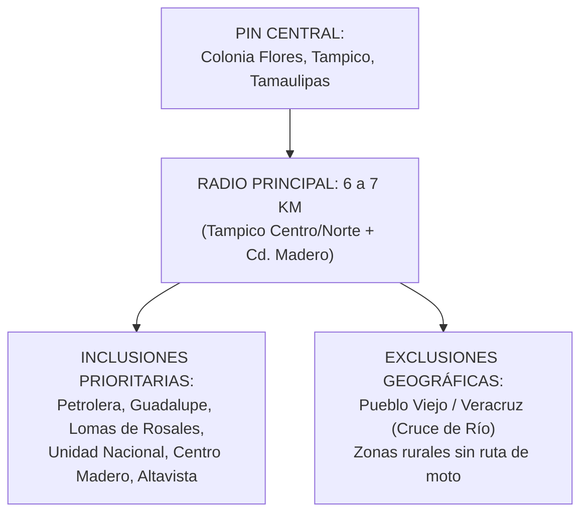

# 🎯 PLAN DE PAUTA LOCAL EN META ADS (FACEBOOK & INSTAGRAM)
## "La Garza Aguachilera" — Tampico & Ciudad Madero
*Estrategia de Ultra-Bajo Presupuesto ($50 a $100 MXN) con Retorno Inmediato a WhatsApp*

---

## 1. FILOSOFÍA DE LA PAUTA LOCAL: "FRANCOTIRADOR GASTRONÓMICO"

Para una servicio exclusivo a domicilio de fin de semana, **pautar de lunes a miércoles es tirar dinero a la basura**. El apetito por la botana de mariscos y la cerveza se despierta en la mente del consumidor en dos momentos clave:
* **Jueves:** Cuando comienza la planeación del descanso y la reunión con amigos/familia.
* **Viernes:** El día de cobro (quincena/semana), salida del trabajo y anticipación de la fiesta o el descanso de fin de semana.

```
+--------------------------------------------------------------------------+
|                     CRONOGRAMA DE GASTO SEMANAL                          |
+--------------------------+-----------------------+-----------------------+
| DÍA                      | PRESUPUESTO DIARIO    | OBJETIVO              |
+--------------------------+-----------------------+-----------------------+
| Lunes a Miércoles        | $0 MXN (Apagado)      | Orgánico puro         |
| Jueves                   | $50 - $75 MXN         | Apertura de Preventa  |
| Viernes                  | $50 - $75 MXN         | Cierre de Cupos       |
| Sábado y Domingo         | $0 MXN (Opcional $50) | Si quedan bolsas      |
| **TOTAL SEMANAL**        | **$100 - $150 MXN**   | **Llenar la cocina**  |
+--------------------------+-----------------------+-----------------------+
```

Con una inversión semanal de solo **$100 a $150 pesos mexicanos**, generamos entre **12 y 25 conversaciones directas de WhatsApp**. Si cerramos el 30%-40% de esos chats (4 a 8 pedidos de 1 o 2 bolsas), generamos entre **$1,020 y $2,720 MXN en ventas**, logrando un **ROAS (Retorno de Inversión) de más de 10x**.

---

## 2. CONFIGURACIÓN TÉCNICA PASO A PASO EN META ADS MANAGER

### Paso 1: Creación de Campaña
1. Ingresa a [Meta Ads Manager](https://adsmanager.facebook.com/).
2. Haz clic en **+ Crear**.
3. **Objetivo de Campaña:** Elige **"Interacción"** o **"Clientes Potenciales"** (dependiendo de la versión de Meta Suite).
4. **Destino de la Conversión:** Selecciona **"Apps de mensajería"** y marca exclusivamente la casilla de **WhatsApp** (vinculada al número de negocio `+52 833 252 0988`).
5. **Nombre de Campaña:** `[GARZA] - Preventa Local WhatsApp - Jue/Vie`.

### Paso 2: Configuración del Conjunto de Anuncios (Ad Set)
* **Presupuesto y Calendario:**
  * Tipo: *Presupuesto diario*.
  * Monto: `$75.00 MXN`.
  * Programación: Iniciar jueves a las 11:00 AM y pausar viernes a las 11:59 PM (o programar reglas automáticas).

---

## 3. SEGMENTACIÓN GEOGRÁFICA Y DEMOGRÁFICA EXACTA

La eficiencia de este presupuesto depende de no mostrar el anuncio a personas que vivan fuera del radio de entrega de la moto o en zonas del otro lado del río Pánuco.



### 3.1 Coordenadas y Radio Geográfico:
1. En la sección **Lugares**, selecciona: **"Personas que viven en este lugar"** (no personas que estuvieron recientemente de paso).
2. Fija un marcador (Drop Pin) en:  
   📍 **Colonia Flores, Tampico, Tamaulipas**  
   *(Coordenadas aproximadas: Latitud 22.255, Longitud -97.858)*.
3. Establece el radio en **6 kilómetros** (cubre de forma óptima Tampico y el corazón urbano de Ciudad Madero).
4. **Exclusiones OBLIGATORIAS:**
   * Haz zoom al sur del Río Pánuco (Pueblo Viejo, Matillas, Anáhuac, Veracruz) y coloca un marcador de **Exclusión** con radio de 2 km para no pagar por clics de personas del estado vecino que requerirían cruzar en lancha/paso de chalán.

### 3.2 Segmentación Demográfica:
* **Edad:** 21 a 45 años *(Poder adquisitivo independiente, mayor consumo de botanas y mariscos de fin de semana)*.
* **Sexo:** Todos (Hombres y Mujeres).
* **Idiomas:** Español (todos).

### 3.3 Segmentación Detallada (Intereses sugeridos):
* Puedes dejarlo en **Público Abierto Local (Broad Targeting)** dentro del radio de 6 km (Meta optimiza mejor la entrega local por el contenido visual del anuncio).
* *O acotar con 1 o 2 intereses clave:* `Mariscos`, `Cerveza`, `Comida rápida`, `Tostitos`.

---

## 4. CREATIVOS LISTOS PARA EJECUTAR (COPIES, FORMATOS Y BOTÓN)

---

### 🎨 ANUNCIO 1: EL ANTOJO CRUJIENTE (Video Vertical 9:16 — Reels & Stories)
* **Formato:** Video MP4 (1080x1920 px), duración 20 a 30 segundos.
* **Visual:** Clip de ella vertiendo el aguachile verde sobre la bolsa de Tostitos y dando una mordida con sonido crujiente real.
* **Ubicaciones:** Instagram Reels, Historias de Instagram y Facebook, Feed de Facebook móvil.

#### 📋 Ficha de Configuración del Anuncio:
* **Texto Principal (Copy):**
```text
¡Llegó a Tampico y Madero el verdadero antojo de fin de semana! 🦐🌊🔥

¿Quién dijo que el aguachile solo se come en plato hondo? En La Garza Aguachilera preparamos los tostiaguachiles más reportados de la zona conurbada:

🟢 CLÁSICOS VERDES: Con serrano, limón Colima fresco, pepino y cebolla morada.
🔴 BRAVOS ROJOS: Con Tostitos Flamin, salsas oscuras y chiles tatemados.

✅ Camarón 100% fresco del Golfo curado al momento.
✅ Empaque especial: Te mandamos el aguachile en contenedor hermético aparte para que tus Tostitos lleguen 100% crujientes hasta tu puerta.

💰 Solo $150 MXN la bolsa bien servida.
🛵 Entregas a domicilio SÁBADOS y DOMINGOS.
📍 Salida desde Col. Flores (Tampico y Madero).

⚠️ Solo preparamos un número limitado de bolsas por fin de semana con camarón fresco de costa. ¡No te quedes sin la tuya!

Toca el botón de aquí abajo y aparta tu lugar por WhatsApp en 1 minuto 👇
```

* **Título (Headline):** `🦐 Tostiaguachiles con Camarón Fresco ($150) | Pide x WhatsApp`
* **Descripción:** `🛵 Entregas en Tampico y Cd. Madero este fin de semana`
* **Llamada a la Acción (Botón):** `Enviar mensaje de WhatsApp`
* **Mensaje Predefinido de WhatsApp:**
  `¡Hola! Vi su video en Instagram/Facebook y quiero apartar mi tostiaguachile para este fin de semana 🦐`

---

### 🖼️ ANUNCIO 2: EL DUELO DE SABORES (Imagen Cuadrada 1:1 o 4:5 — Feed)
* **Formato:** Imagen de alta resolución (1080x1350 px o 1080x1080 px).
* **Visual:** Fotografía dividida en diagonal o mitad y mitad: a la izquierda la bolsa verde rebosante de camarones y limón; a la derecha la bolsa roja Flamin con salsas negras y chiles secos. Arriba el logo de La Garza y un badge: **"$150 MXN | Camarón de adeveras"**.

#### 📋 Ficha de Configuración del Anuncio:
* **Texto Principal (Copy):**
```text
¿Team Verde o Team Rojo? 🤔 En Tampico la decisión se pone seria...

En La Garza Aguachilera no andamos con camarón chiquito ni congelado. Te mandamos tu bolsa de auténticos TOSTITOS SALSA VERDE retacada de camarón fresco del Golfo:

🟢 VERDE TRADICIONAL: Acidito, fresco y tradicional con chile serrano, pepino, cebolla morada y mucho limón.

✨ El producto es preparado frente a usted para corroborar su frescura.

🛵 Entregas a domicilio SÁBADOS y DOMINGOS en Tampico y Cd. Madero.
💰 $150 la bolsa bien reportada.

👉 ¡Preventa abierta para este fin de semana! Toca el botón para armar tu pedido antes de que se agoten los cupos.
```

* **Título:** `🟢 Tostiaguachile Verde Tradicional | $150 MXN`
* **Descripción:** `Envío a domicilio en Tampico y Madero 🛵`
* **Llamada a la Acción (Botón):** `Enviar mensaje de WhatsApp`
* **Mensaje Predefinido de WhatsApp:**
  `Hola, quiero pedir informes y agendar mi pedido de tostiaguachiles 🌊`

---

## 5. REGLAS DE OPTIMIZACIÓN Y MONITOREO DE COSTOS

Para no desperdiciar ni un solo peso de los $50-$100 diarios:

```
+--------------------------------------------------------------------------+
|                     MÉTRICAS CLAVE (KPIs ESPERADOS)                      |
+--------------------------+-----------------------+-----------------------+
| MÉTRICA                  | VALOR ÓPTIMO SALUDABLE| ACCIÓN SI SE DESVÍA   |
+--------------------------+-----------------------+-----------------------+
| Costo por Conversación   | $4.00 a $10.00 MXN    | Si sube de $15, cambiar|
| (CPR en WhatsApp)        |                       | creativo o copy       |
| CTR (Clics en el enlace) | > 2.0%                | Si baja de 1%, mejorar|
|                          |                       | gancho visual (primeros 3s)
| Cierre de Venta en Chat  | 30% a 50% de chats    | Pulir respuesta rápida|
|                          | convertidos en dinero | de WhatsApp           |
+--------------------------+-----------------------+-----------------------+
```

### Reglas de Operación Diaria:
1. **Regla de Apagado por Cocina Saturada:** Si el viernes a las 7:00 PM ya se vendieron las 80 bolsas del sábado y domingo en preventa, **pausar la campaña inmediatamente**.
2. **Duplicación de Ganadores:** Si el Anuncio en Video 1 genera mensajes a $5.50 MXN y el Anuncio 2 los genera a $12.00 MXN, apagar el Anuncio 2 y concentrar los $100 MXN diarios en el Video 1.
3. **Pico de Horario:** Los horarios con mayor conversión para comida en Tampico son:
   * Jueves: 6:00 PM a 10:00 PM.
   * Viernes: 12:30 PM a 3:30 PM y 6:00 PM a 11:00 PM.
