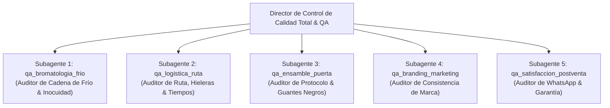

# 🛡️ MANUAL MAESTRO DE CONTROL DE CALIDAD TOTAL, BROMATOLOGÍA Y EXCELENCIA OPERACIONAL
## LA GARZA AGUACHILERA — TAMPICO & CIUDAD MADERO
**Versión:** 1.0 Oficial | **Fecha:** Octubre 2026 | **Área:** Dirección General de Calidad & Operaciones  
**Base Operativa:** Colonia Flores, Tampico, Tamaulipas  
**Marco Normativo de Referencia:** NOM-251-SSA1-2009 / Sistema HACCP / Buenas Prácticas de Manufactura (BPM)

---

## 🦅 1. DECLARACIÓN DE FILOSOFÍA Y ESTÁNDAR SUPREMO

En **La Garza Aguachilera**, la calidad no es un departamento ni una lista de deseos: **es la razón de existir del negocio**. Operar una *servicio exclusivo a domicilio* de mariscos crudos en una región con clima tropical extremo como Tampico y Ciudad Madero (donde las temperaturas oscilan de 30°C a 38°C con sensaciones térmicas de hasta 44°C y humedad superior al 85%) exige un rigor microbiológico y una disciplina operativa intransigente.

### Los Tres Principios Innegociables de Calidad:
1. **Inocuidad Cero Riesgos:** El camarón crudo es un alimento biológicamente vulnerable. La cadena de frío no se interrumpe jamás.
2. **La Promesa Sagrada:** *"El producto es preparado frente a usted para corroborar su frescura"*. No enviamos alimentos pre-ensamblados ni totopos ablandados; llevamos el espectáculo higiénico y culinario hasta la puerta del comensal.
3. **Consistencia Absoluta de Marca:** Una sola receta estelar ejecutada a la perfección: **Tostiaguachile Verde Tradicional a $150 MXN**, con Tostitos Salsa Verde oficiales, camarón mariposa de costa impecable y marinada tradicional en su punto exacto. Cero dispersiones operativas.

---

## ❄️ 2. PROTOCOLO DE INOCUIDAD, BROMATOLOGÍA Y CADENA DE FRÍO

Conforme a la norma mexicana **NOM-251-SSA1-2009** (*Prácticas de higiene para el proceso de alimentos, bebidas o suplementos alimenticios*) y los principios del Análisis de Peligros y Puntos Críticos de Control (**HACCP**), se establecen los siguientes lineamientos obligatorios para la cocina de producción (Col. Flores) y el transporte a domicilio:

```
+---------------------------------------------------------------------------------+
|                       MAPA DE CADENA DE FRÍO CRÍTICA                           |
|                                                                                 |
| [ Recepción Proveedor ] ---> [ Cámara Fría / Hielo ] ---> [ Porcionado Frío ]  |
|      (0°C a 3°C)                  (0°C a 2°C)                  (≤ 4°C máx 15m)  |
|                                                                       |         |
| [ Ensamble en Domicilio ] <--- [ Hielera Ruta ] <--- [ Sellado Hermético Bote ]|
|    (Frente al cliente)           (0°C a 4°C)               (Con gel eutéctico)  |
+---------------------------------------------------------------------------------+
```

### 2.1 Criterios de Aceptación y Rechazo del Camarón Crudo (PCC-1: Recepción)
Todo lote de camarón proveniente del Golfo / La Puntilla debe someterse a inspección sensorial inmediata a su llegada a cocina:
* **Temperatura de recepción obligatoria:** Entre **0°C y 3°C**. Si el lote llega a más de 4.0°C, se rechaza de inmediato.
* **Olor:** Aroma limpio a brisa marina o neutro. *Rechazo automático:* Olor amoniacal, agrio, sulfuroso o a humedad estancada.
* **Textura y Consistencia:** Carne firme, elástica y traslúcida; al presionar con el dedo enguantado debe recuperar su forma de inmediato. *Rechazo:* Carne blanda, lechosa, pastosa o viscosa.
* **Color:** Blanco grisáceo natural o ligeramente aperlado. *Rechazo:* Manchas negras (melanosis avanzada en cuerpo), tonalidades amarillentas o rojizas por descomposición.
* **Integridad:** Sin desprendimiento espontáneo del cefalotórax o caparazón blando por degradación.

### 2.2 Desinfección y Lavado de Materias Primas Vegetales (PCC-2)
Los vegetales que no reciben cocción térmica son vectores potenciales de contaminación cruzada (*Escherichia coli*, *Salmonella spp.*).
* **Pepino:**
  * Lavado mecánico con agua purificada y cepillo suave de cerdas sanitarias para remover tierra o ceras superficiales.
  * Inmersión en solución desinfectante (plata coloidal a 10 gotas por litro o microbicida clorado a 50 ppm) durante 10 minutos cronometrados.
  * Pelado parcial (rayado longitudinal estético) y corte en medias lunas calibradas a 3.0 mm exactos, previa desinfección de cuchillo y tabla plástica verde.
* **Cebolla Morada:**
  * Retiro de las dos capas externas secas. Lavado e inmersión desinfectante.
  * Corte en julianas finas (plumas de 1.5 a 2.0 mm).
  * *Técnica de Desfleme en Frío:* Reposo de 10 minutos en agua purificada helada (con cubos de hielo) para eliminar el exceso de sulfuros picantes sin perder el crujido celular, seguido de centrifugado/escurrido total.
* **Cilantro Fresco Criollo:**
  * Deshoje manual eliminando tallos gruesos leñosos o follaje marchito.
  * Triple lavado por inmersión y desinfección con solución de dióxido de cloro o extracto cítrico grado alimenticio.
  * Secado centrífugo obligatorio antes del picado para evitar emulsiones acuosas que pudran la salsa.
* **Limón Colima (El Corazón Ácido):**
  * Lavado externo con agua y jabón grado alimenticio para remover polvo y residuos del campo.
  * Corte transversal a 90° y extracción mediante prensa manual de palanca o exprimidor de copa a 1/2 carrera: **estrictamente prohibido sobreexprimir el limón hasta exprimir el albedo (parte blanca interior)**, pues libera terpenos amargos que destruyen el perfil del aguachile.
  * El jugo debe extraerse en lotes controlados para el servicio del día; nunca usar jugos enlatados, sulfatados ni concentrados químicos.

### 2.3 Manejo Térmico y Peligros Biológicos en Tampico (Zona de Peligro: 4°C a 60°C)
Bajo el calor de Tampico y Madero (35°C promedio en sombra), una bolsa de mariscos expuesta al ambiente entra en zona de peligro en menos de 8 minutos.
* **Patógenos Críticos:**
  * *Vibrio parahaemolyticus* y *Vibrio vulnificus:* Bacterias halófilas marinas que se duplican cada 12 minutos a más de 20°C.
  * Formación de histamina por degradación de aminoácidos libres.
* **Barrera de Seguridad:**
  1. El pH del jugo de limón Colima (pH 2.2 a 2.4) desnaturaliza las proteínas del camarón y abate patógenos superficiales, pero **no sustituye la refrigeración**.
  2. El camarón mariposa se mantiene sumergido en recipientes gastronómicos de acero inoxidable sobre lecho continuo de hielo en escama dentro de la nevera a **1°C a 3°C** hasta el momento exacto de asignación a ruta.

### 2.4 Almacenamiento y Protección de los TOSTITOS SALSA VERDE
La humedad relativa en la costa de Tampico suele superar el 85%.
* El totopo de maíz nixtamalizado absorbe humedad ambiental velozmente, perdiendo su factor crítico de compra: el **"Crunch"**.
* Las cajas y bolsas maestras de Tostitos Salsa Verde oficiales deben conservarse en anaqueles plásticos elevados a 15 cm del piso, en bodega seca con aire acondicionado o deshumidificador a menos de 24°C y 50% de humedad.
* Queda prohibido apilar cajas pesadas sobre los empaques de Tostitos para evitar rotura de totopos; el cliente paga por totopos íntegros, no por migajas.

---

## 🛵 3. PROTOCOLO OPERACIONAL DE ENSAMBLADO EN DOMICILIO
### *"El producto es preparado frente a usted para corroborar su frescura"*

Este protocolo es el mayor elemento diferenciador de **La Garza Aguachilera**: convierte una simple entrega a domicilio en una experiencia de teatro culinario, transparencia quirúrgica y garantía sensorial.

```
+---------------------------------------------------------------------------------+
|                   SECUENCIA DE ENSAMBLE EN LA PUERTA (120 - 150 SEG)            |
|                                                                                 |
| 1. Presentación Pulcra  ---> 2. Sanitización Visble  ---> 3. Guantes Negros     |
| 4. Apertura de Bolsa    ---> 5. Vertido & Acomodo    ---> 6. Entrega y Cierre   |
+---------------------------------------------------------------------------------+
```

### 3.1 Indumentaria y Estándar de Presencia del Repartidor-Ensamblador
El personal en calle no es un repartidor común de plataforma; es un embajador gastronómico de la marca.
* **Uniforme Obligatorio:**
  * Playera tipo polo o playera de cuello redondo oficial de **La Garza Aguachilera** en color Blanco Nítido o Azul Marino Oficial (#0D2238), impecablemente planchada y sin manchas.
  * Mandil pechero impermeable de vinil negro mate o gabardina azul marino con logo bordado en el pecho.
  * Gorra cerrada oficial de La Garza con visera al frente, conteniendo el 100% del cabello. Prohibido cabello suelto o gorras hacia atrás.
  * Pantalón negro o de mezclilla oscura sin roturas ni desgarres; calzado cerrado antiderrapante y limpio.
* **Higiene Personal:**
  * Uñas cortas, limpias y cepilladas; barba afeitada o recortada al ras con cubrebarba si aplica; perfume discreto (evitar fragancias intensas que interfieran con el aroma de la comida).

### 3.2 Equipo Térmico de Ruta y Estación Móvil (Logística Fría)
* **Hielera Gigante de Transporte Térmico:**
  * Hielera de gran volumen aislada térmicamente, con sello hermético de alta retención para soportar el clima cálido-húmedo de Tampico y Madero.
  * **2 Cubetas Grandes de Grado Alimenticio:** Contenedores sanitarios certificados para contacto directo con alimentos, donde viaja el material (camarón mariposa y marinada verde en porciones frías sobre cama de hielo).
  * **Termómetros Integrados:** Cada cubeta cuenta con termómetro (sonda/análogo o digital) visible para monitoreo ininterrumpido garantizando una temperatura de **0°C a 4°C** constante.
* **Mesa de Preparación Plegable en Sitio:**
  * Mesa compacta, higiénica y desinfectada que el repartidor despliega frente al cliente en el domicilio para realizar el montaje quirúrgico y ordenado del platillo.
* **Maletín de Ensamble Sanitario (Carry-on):**
  * Dispensador de gel antibacterial con alcohol al 70%.
  * Caja dispensadora de **Guantes de Nitrilo Negros** grado alimenticio (tallas M y L).
  * Tijeras profesionales de cocina en acero inoxidable (desinfectadas tras cada servicio).
  * Toallas húmedas desinfectantes empacadas individualmente.
  * Kit de cortesía por comensal: Tenedores biodegradables reforzados en funda sellada individual y servilletas de alta absorción.

### 3.3 Protocolo Paso a Paso en la Puerta del Cliente (Tiempo Estándar: 2 minutos 15 segundos)

1. **Contacto Inicial y Saludo Corporativo (0 a 20 seg):**
   * El repartidor toca el timbre o llama al cliente según las instrucciones de WhatsApp.
   * Al abrir el comensal, saluda con contacto visual directo y tono cordial:
     > *"¡Buenas tardes, [Nombre del Cliente]! Traigo su orden de La Garza Aguachilera. Como sabe, nuestro compromiso sagrado es que su producto se prepara frente a usted para corroborar su frescura y temperatura."*

2. **Apertura de Estación y Colocación de Guantes (20 a 45 seg):**
   * El repartidor abre la hielera térmica, extrae la charola de apoyo limpia.
   * Aplica gel antibacterial en sus manos frente al cliente, frota por 10 segundos y **se calza un par de guantes de nitrilo negros nuevos a la vista del comensal**. Este acto transmite pulcritud médica y elegancia de cocina moderna.

3. **Apertura Técnica de la Bolsa de Tostitos (45 a 65 seg):**
   * Extrae la bolsa individual sellada de **Tostitos Salsa Verde Oficiales**.
   * Con la tijera desinfectada, realiza un corte longitudinal horizontal limpio en la parte superior o lateral superior de la bolsa, abriendo un ancho de servicio cómodo para el comensal sin aplastar los totopos interiores.

4. **Extracción y Ensamble del Aguachile Frío (65 a 115 seg):**
   * Extrae de la hielera el contenedor hermético frío (que viene sellado con fajilla de garantía) con la porción exacta de camarón mariposa, pepino en media luna, plumas de cebolla morada y la marinada verde tradicional helada.
   * Muestra brevemente el contenedor: *"Mire la frescura y el corte de nuestro camarón del Golfo..."*
   * Rompe el sello y vierte de forma uniforme la marinada y los vegetales sobre la cama de Tostitos, distribuyendo con pinza o espátula de silicón los camarones mariposa en la parte superior para coronar la presentación visual (**Food Styling en vivo**).

5. **Entrega y Cierre de Experiencia (115 a 140 seg):**
   * Entrega la bolsa montada al cliente en mano o en su base protectora, acompañada del tenedor sellado y servilletas.
   * Frase de despedida reglamentaria:
     > *"¡Listo, [Nombre del Cliente]! Aquí tiene su Tostiaguachile Verde Tradicional recién montado, bien reportado de camarón y 100% crujiente. ¡Que lo disfrute con su bebida favorita!"*
   * El repartidor se retira los guantes doblándolos hacia adentro, los deposita en la bolsa de residuos de su maletín y desinfecta las tijeras para el siguiente domicilio.

---

## 📏 4. ESTÁNDAR TÉCNICO DE PRODUCTO: TOSTIAGUACHILE VERDE TRADICIONAL ($150 MXN)

La sencillez operativa es la clave de la rentabilidad y la perfección culinaria. No existen variantes, no hay aguachile rojo ni selector de picor.

```
+---------------------------------------------------------------------------------+
|               FICHA TÉCNICA: TOSTIAGUACHILE VERDE TRADICIONAL                   |
+-------------------------------------+-------------------------------------------+
| Parámetro                           | Especificación Oficial                    |
+-------------------------------------+-------------------------------------------+
| Precio Oficial al Público           | $150.00 MXN                               |
| Base Botana                         | 1 Bolsa de Tostitos Salsa Verde Oficial    |
|                                     | (Contenido neto comercial 60g - 65g)      |
| Calibre de Camarón                  | Calibre 36/40 o 41/50 costa del Golfo     |
| Peso Neto de Camarón por Porción    | 100 gramos aprox de camarón crudo limpio  |
| Conteo de Piezas de Camarón         | 8 a 10 camarones mariposa enteros         |
| Tipo de Corte del Marisco           | Corte Mariposa profundo dorsal, desvenado |
| Vegetal 1: Pepino Criollo/Persa     | 45 gramos (Medias lunas de 3 mm)          |
| Vegetal 2: Cebolla Morada           | 25 gramos (Juliana fina desflemada)       |
| Follaje: Cilantro Criollo           | 5 gramos (Picado fino, hojas limpias)     |
| Base Ácida: Jugo de Limón Colima    | 55 ml a 65 ml recién exprimido a mano     |
| Base Picante: Chile Serrano Fresco  | 10 a 12 gramos (Picante por naturaleza)   |
| Salazón y Especias                  | Sal de grano de la región + pimienta negra|
|                                     | y toque secreto ligero de sazonador umami |
| pH Objetivo de la Marinada          | 2.3 a 2.6 (acidez limpia y desinfectante) |
| Temperatura de Servicio al Montar   | 1°C a 3°C (sensación helada refrescante)  |
+-------------------------------------+-------------------------------------------+
```

### 4.1 Ficha de Anatomía del Producto
1. **El Camarón:**
   * Prohibido terminantemente el camarón pacotilla (pequeño y fibroso).
   * Prohibido camarón cocido industrial o camarón con restos de cáscara o patas.
   * El corte mariposa debe ser simétrico, dejando las dos mitades unidas por el lomo ventral, con la vena dorsal (tracto digestivo) retirada al 100% con lavado a chorro de agua fría filtrada.
2. **El Jugo y la Marinada Verde:**
   * Color: Verde esmeralda vivo y brillante (logrado por emulsión de cilantro fresco, serrano verde intenso y limón recién exprimido).
   * Sabor: Ataque ácido vibrante, seguido del picor del serrano fresco que calienta la boca sin anestesiar el paladar, balanceado por la dulzura natural del camarón de costa y el crujido salado del Tostito verde.
3. **Cero Tolerancia a Desvíos y Política de Picor:**
   * No se permite el uso de Tostitos de forma triangular ni de otras marcas o sabores.
   * No se aceptan bolsas de Tostitos con aire aplastado o producto quebrado.
   * **El producto viene picante por naturaleza:** Es la receta e identidad indiscutible de La Garza Aguachilera. No se aceptan solicitudes de modificación de picante ("sin chile" o "medio picoso"), ni proceden reembolsos o cambios por sensibilidad al picante del comensal. Quien pide aguachile en Tampico busca picor y frescura auténtica.

---

## 👥 5. MATRIZ Y DESPLIEGUE DE SUBAGENTES ESPECIALIZADOS DE CALIDAD

Bajo las facultades conferidas por la Dirección General de La Garza Aguachilera, se constituye el **Cuerpo Técnico de Auditoría Categórica de Calidad**. Cada subagente opera con objetivos puntuales, protocolos de revisión continua y reporte directo a esta Dirección:



### Matriz de Responsabilidades y Monitoreo:

| Subagente | Clave Interna | Misión Crítica y Alcance Operativo | Frecuencia de Auditoría |
| :--- | :--- | :--- | :--- |
| **Auditor de Bromatología y Cadena de Frío** | `qa_bromatologia_frio` | Inspeccionar temperaturas de recepción en cocina (0°-3°C), higiene de vegetales, bitácoras de desinfección bajo NOM-251 y estado del camarón en La Puntilla. | Cada viernes y antes de iniciar turno de fin de semana. |
| **Auditor de Logística Térmica y Tiempos de Ruta** | `qa_logistica_ruta` | Monitorear hieleras en ruta (0°-4°C), tiempos de traslado desde Col. Flores a colonias clave (Petrolera, Madero, etc.) y planes de contingencia por tráfico o calor extremo. | Durante la jornada de entregas (Sábados y Domingos 1:00 - 5:00 PM). |
| **Auditor de Ensamble y Experiencia en Puerta** | `qa_ensamble_puerta` | Auditar la presencia del repartidor, pulcritud de polo/mandil, colocación de guantes de nitrilo negros frente al cliente, técnica de apertura de bolsa y respeto al tiempo límite de 2.5 min. | Monitoreo por muestreo semanal y retroalimentación de clientes. |
| **Auditor de Consistencia de Marca y Contenidos** | `qa_branding_marketing` | Escaneo estricto de web (`index.html`), redes (TikTok, Instagram, Facebook) y flyers. Eliminar cualquier residuo de Tostitos Rojos, selector de picor o leyendas obsoletas. Verificar que siempre aparezca el Verde Tradicional ($150) y TOSTITOS SALSA VERDE. | Auditoría semanal permanente en archivos y publicaciones. |
| **Auditor de Satisfacción al Cliente y Retención** | `qa_satisfaccion_postventa` | Supervisar el envío del mensaje de post-venta a los 45 minutos vía WhatsApp, monitorear el Net Promoter Score (NPS), gestionar quejas y aplicar la política de garantía de satisfacción. | Sábados y Domingos a partir de las 2:00 PM y cierre semanal. |

---

## 🎯 6. PROTOCOLO DE AUDITORÍA CONTINUA Y GESTIÓN DE INCIDENCIAS

1. **Semáforo de Temperatura de Servicio:**
   * 🟢 **0.0°C a 3.5°C:** Temperatura Óptima (Excelencia Bromatológica).
   * 🟡 **3.6°C a 4.5°C:** Advertencia Operativa (Revisar placas eutécticas o sellos de hielera).
   * 🔴 **> 4.5°C:** Detención Inmediata de Entrega. El producto no sale a comensal; se sustituye por lote frío de reserva.
2. **Garantía Incondicional de Frescura Garza:**
   Si por cualquier circunstancia un cliente reporta totopo húmedo, falta de acidez o desvío físico en camarón, la política de la empresa es:
   * Reemplazo sin costo en el siguiente bloque de ruta o devolución inmediata del 100% vía SPEI en menos de 15 minutos, sin discusiones ni fricción. (Nota: No aplica para nivel de picor, ya que el producto es picante por naturaleza).
3. **Contingencia por Lluvia y Clima Costero:**
   * En caso de lluvia fuerte o norte en Tampico y Ciudad Madero, el servicio de entregas a domicilio **permanece activo**.
   * Se aplica un **recargo extra en el costo de envío dependiendo de la distancia y zona de entrega**, compensando el esfuerzo y garantizando el traslado seguro del repartidor y el equipo térmico.
4. **Capacidad y Límite de Producción por Tanda:**
   * El tope estándar de producción es de **75 bolsas por tanda**, pudiendo calibrarse hacia arriba o hacia abajo según la oferta de marisco de primera calidad en La Puntilla.

---
**Aprobado por:** Dirección de Control de Calidad Total, Bromatología y Excelencia Empresarial  
**La Garza Aguachilera — Sabor y Crunch Costero 100% Tampiqueño** 📍🦐
